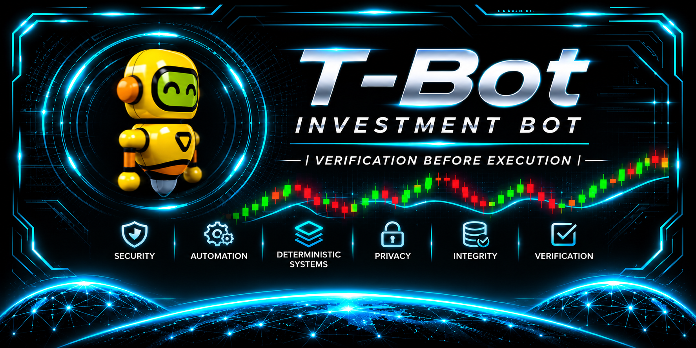

# T-Bot | Investment BOT

**Local-first Solana research · Rule-based decision design · Security review in progress**

**ProcessOverProfit — Verification Before Execution**

I'm independently developing T-Bot, a local-first Solana trading system, while learning software engineering through hands-on development. I use AI to help research, write and review software. The intended trading decision path is rule-based, not an AI model selecting trades. The project is not a qualified operational trading system or a public product.

**Security is a design objective, not an assurance claim.** AI-assisted review can miss defects or produce incorrect conclusions. No completed independent human security audit or system-wide qualification is asserted.

## Project overview

| Area | Public description |
| --- | --- |
| Platform | Linux; local-first development |
| Market focus | Solana |
| Project type | Privately developed automated trading system |
| Current phase | Active private development and security qualification |
| Live-money execution | Not currently authorised |
| Public distribution | Documentation and standalone educational lab; no operational application release |

**Start here:** [FAQ](docs/FAQ.md) · [Publication checklist](docs/PUBLICATION_CHECKLIST.md) · [Evidence template](docs/EVIDENCE_REPORT_TEMPLATE.md) · [Community conduct](CODE_OF_CONDUCT.md) · [Engineering HQ](https://github.com/processoverprofit-sys/Processoverprofit-sys)

## Developers: start here

Choose a [starter task](community/START_HERE.md), inspect the [standalone offline lab](examples/review_gate/README.md), or help improve its tests. The example is newly written, not extracted from T-Bot, and is [MIT-licensed](examples/review_gate/LICENSE). The licence applies only to the standalone lab. It cannot trade or interact with wallets. Its results are not T-Bot qualification evidence.

Discuss ideas with the ProcessOverProfit Discord community. [Request joining guidance](https://github.com/processoverprofit-sys/Processoverprofit-sys/blob/main/docs/COMMUNITY.md#requesting-discord-access) through the Reddit or other existing community discussion where permitted. A verified direct application link is pending.

## Technical documentation

Community feedback highlighted that an overview alone does not give developers enough information to assess engineering decisions. This documentation responds to that feedback without disclosing the private application.

| Document | What it covers |
| --- | --- |
| [Development status](docs/DEVELOPMENT_STATUS.md) | What is known, what remains unqualified, and how reviews are described |
| [Architecture](docs/ARCHITECTURE.md) | Conceptual components and trust boundaries |
| [Risk principles](docs/RISK_PRINCIPLES.md) | Intended risk-control requirements, not live configuration |
| [Threat model](docs/THREAT_MODEL.md) | Selected threats, intended controls and open questions |
| [Testing and examples](docs/TESTING.md) | Proposed test methodology, illustrative cases and evidence limitations |
| [Community feedback](docs/COMMUNITY_FEEDBACK.md) | How feedback is being addressed and where developers can help |

## Does AI decide what to trade?

No, not in the intended design. Eligibility and risk decisions are defined by explicit rules over validated inputs and policy state. Given identical inputs, policy version and relevant state, the same rule-based decision is expected. AI is an engineering aid, not a decision-maker or source of execution authority. Eligibility alone cannot authorise a transaction. These boundaries are design requirements that still need implementation-level evidence; reproducibility does not guarantee a profitable or safe trade.

See [architecture](docs/ARCHITECTURE.md), [risk principles](docs/RISK_PRINCIPLES.md) and [testing](docs/TESTING.md).

## Engineering principles

- **Local-first boundaries:** controlled operation and separation of responsibilities.
- **Deterministic risk:** explicit rules and bounded risk rather than LLM-controlled trading decisions.
- **Fail-closed validation:** invalid or missing critical conditions prevent execution.
- **Signing separation:** transaction-signing authority is distinct from broader application activity.
- **Evidence-led engineering:** auditable testing and structured verification.
- **Explicit authorisation:** controlled execution boundaries rather than implicit permission.

These principles describe the intended architecture. They do not constitute independent security certification.

## Development status

Active private development and security qualification. T-Bot is not publicly released, not represented as production-ready and not currently authorised for live-money execution. No trading performance, profitability or financial return is claimed. See [development status](docs/DEVELOPMENT_STATUS.md) for the distinction between design goals and demonstrated evidence.

## Public repository scope

This repository contains documentation and a separate, non-operational educational example. It does not distribute operational T-Bot source, application binaries, trading strategies, live risk thresholds, internal configurations, wallet addresses, signing credentials, API keys or private security evidence. See [rights notice](LICENSE-NOTICE.md) for current licensing scope.

For the wider portfolio, visit [ProcessOverProfit | Engineering HQ](https://github.com/processoverprofit-sys/Processoverprofit-sys). [BrainBot](https://github.com/processoverprofit-sys/BrainBot) is documented separately.

## Join the ProcessOverProfit community

I've set up a dedicated ProcessOverProfit Discord community for developers, Linux enthusiasts and people interested in learning together. GitHub and Discord are connected through automated repository notifications.

If you'd like to help, you're welcome to express interest in discussing software architecture, Python, Solana, risk-control design, testing or the public documentation. You don't need to be an expert to join the conversation. Constructive feedback and questions are welcome.

**Joining guidance:** [ProcessOverProfit community guide](https://github.com/processoverprofit-sys/Processoverprofit-sys/blob/main/docs/COMMUNITY.md#requesting-discord-access). Discord access is managed by the maintainer. If you found this project through Reddit or another community discussion, you can ask me there for an invitation where the community rules permit. No public invite is listed here at present. Joining Discord does not grant access to private source code, operational systems or trading authority.

## Feedback and security

I'm looking for constructive feedback on the public documentation, not customers or funds. Public Issues are currently disabled. Non-sensitive lab improvements and documentation corrections may be proposed through public pull requests under [CONTRIBUTING.md](CONTRIBUTING.md). See [community feedback](docs/COMMUNITY_FEEDBACK.md) for specific questions and [SECURITY.md](SECURITY.md) for confidential reporting. Do not disclose vulnerabilities or private information publicly.

## Financial disclaimer

This repository is not an investment service, trading product, investment recommendation or offer to manage funds. No financial advice or trading performance is provided.

---

**Developed on Linux.**

**Process Over Profit — Verification Before Execution.**
