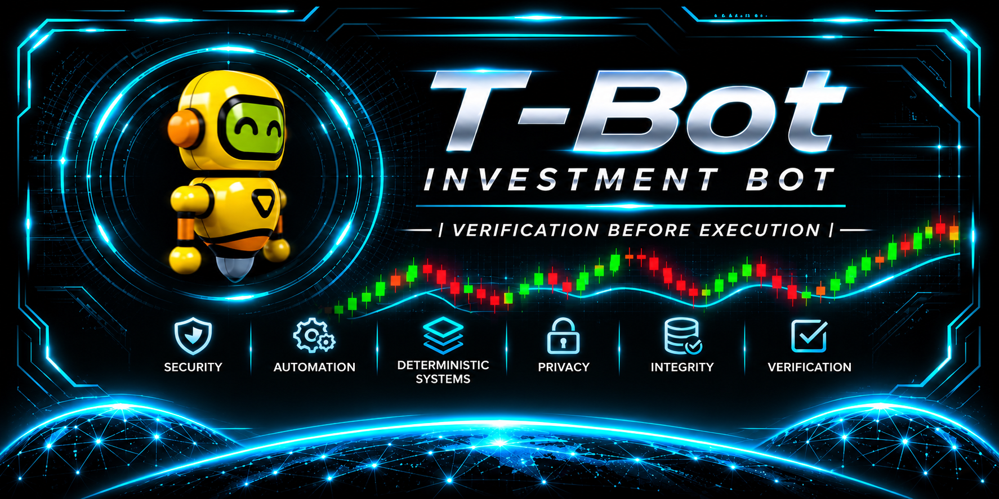

# T-Bot | Investment BOT

**Local-first Solana engineering · Deterministic risk controls · Security qualification**

**ProcessOverProfit — Verification Before Execution**

T-Bot is an independently developed, local-first automated trading system focused on Solana markets. Its development goals include deterministic risk controls, defensive validation and verification before execution. These are **design objectives**, not a claim that every control is implemented or independently verified.

**Navigate:** [Overview](#project-overview) · [Engineering principles](#engineering-principles) · [Status](#development-status) · [Public scope](#public-repository-scope) · [Feedback](#feedback-and-security) · [Disclaimer](#financial-disclaimer)

---

## Project overview

| Area | Public description |
| --- | --- |
| **Platform** | Linux; local-first development |
| **Market focus** | Solana |
| **Project type** | Privately developed automated trading system |
| **Current phase** | Active private development and security qualification |
| **Live-money execution** | **Not currently authorised** |
| **Public distribution** | Documentation only; no executable release |

## Engineering principles

- **Local-first boundaries:** controlled operation and separation of responsibilities.
- **Deterministic risk:** explicit decision rules and bounded risk rather than LLM-controlled trading decisions.
- **Fail-closed validation:** invalid or missing critical conditions prevent execution.
- **Signing separation:** transaction-signing authority is distinct from broader application activity.
- **Evidence-led engineering:** auditable testing and structured verification.
- **Explicit authorization:** controlled execution boundaries rather than implicit permission.

These principles describe the intended architecture and engineering approach; they do not constitute an independent security certification.

## Development status

**Active private development and security qualification.** T-Bot is **not publicly released, not represented as production-ready and not currently authorised for live-money execution**.

No trading performance, profitability or financial return is claimed or promised.

## Public repository scope

This repository is a **documentation-only overview**. It does not provide source code, executable software, trading strategies, internal configurations, wallet addresses, signing credentials, API keys or private security evidence.

For the wider engineering portfolio, visit [ProcessOverProfit | Engineering HQ](https://github.com/processoverprofit-sys/Processoverprofit-sys). BrainBot is documented separately in the [BrainBot repository](https://github.com/processoverprofit-sys/BrainBot).

## Feedback and security

General, non-sensitive feedback on testing methodology, software reliability, risk-control principles and defensive engineering may be considered in the future. **Public Issues are currently disabled.** If enabled later, read [CONTRIBUTING.md](CONTRIBUTING.md) and [SECURITY.md](SECURITY.md) first.

Do not disclose vulnerabilities, credentials, wallet details or private project information in public discussions.

## Financial disclaimer

This repository is not an investment service, trading product, investment recommendation or offer to manage funds. No financial advice or trading performance is provided.

---

**Developed and used on Linux.**

**Process Over Profit — Verification Before Execution.**
