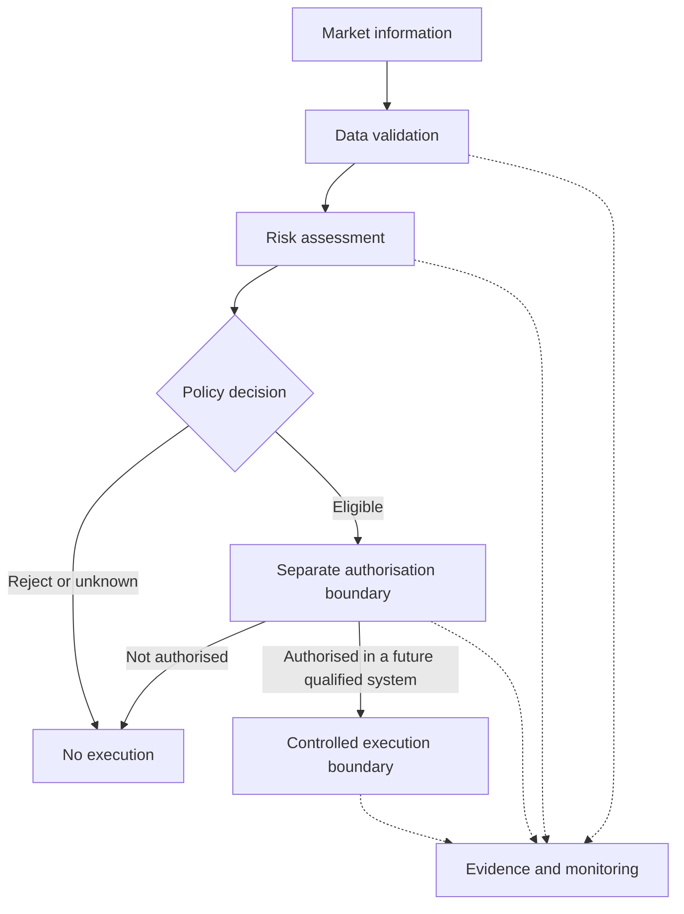

# Conceptual architecture

**Scope:** A public, high-level design model for discussion. It is not an as-built diagram, runtime specification or implementation audit.

The diagram describes intended logical responsibilities. It does not imply that the execution path is currently qualified or enabled.

## Responsibilities and boundaries

| Responsibility | Intended behaviour |
| --- | --- |
| Market information | Treat external observations as potentially incomplete, stale or unreliable. |
| Validation | Detect missing or invalid critical inputs before downstream decisions. |
| Risk assessment | Evaluate explicit requirements; do not substitute an AI opinion for a required rule. |
| Authorisation | Keep eligibility distinct from permission to execute. |
| Execution | Remain unavailable without required authorisation and qualification. |
| Evidence | Record decisions and outcomes in a form suitable for later review. |

AI-assisted engineering is separate from trading authority. A deterministic decision can be reproducible on identical inputs, but cannot make markets predictable or remove losses. External market conditions can change between observation and any attempted action.

The public GitHub documentation and Discord notifications are communication channels only. They provide no route into private signing, wallets, execution or operational resources.

## Review questions

- How should a test specification distinguish missing, invalid and stale observations?
- What evidence would show that an eligibility decision cannot bypass a separate authorisation boundary?
- How should a design represent uncertainty and changes between assessment and execution?

See [risk principles](RISK_PRINCIPLES.md) and [threat model](THREAT_MODEL.md).
